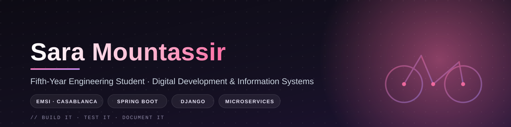

<div align="center">

<!-- Hero: animated typing header -->
<a href="https://github.com/sara-mountassir">
  
</a>

<br/>

<!-- Status badges -->
<p align="center">
  
  
</p>

<!-- Profile card -->
```text
+-----------------------------------------------------------------------------+
|  STUDENT      : SARA MOUNTASSIR // EMSI CASABLANCA                          |
|  PROGRAMME    : DIGITAL DEVELOPMENT & INFORMATION SYSTEMS (2022 - PRESENT)  |
|  FOCUS        : WEB BACKEND / DATABASES / MICROSERVICES                     |
|  INTERNSHIPS  : AI PERFORMANCE (WEB) / TECTRA (SYSTEMS & NETWORK)           |
|  CURRENTLY    : BIKE-FLOW - SPRING BOOT MICROSERVICES (JAVA 17)             |
|  PHILOSOPHY   : "BUILD IT, TEST IT, DOCUMENT IT."                           |
+-----------------------------------------------------------------------------+
```

</div>

---

### ✨ Projects & Academic Work

> *From Django CRUD apps to a layered Spring Boot microservice — built, tested and documented.*

| Project | What it does | Stack |
| :--- | :--- | :--- |
| 🌸 ****CareerJob**** | Job board platform: recruiters publish offers, candidates apply and follow their status, profiles managed end-to-end. | `Django` • `Python` • `HTML/CSS` • `SQLite` |
| 🚲 **[BikeFlow — service-flotte](https://github.com/yassinetouli/BikeFlow-)** | Vehicle & station microservice of a bike-sharing platform: 4-layer architecture, dedicated MySQL database, Bean Validation, error mapping 400/404/409, 15 saved Postman scenarios + 17 JUnit tests. | `Java 17` • `Spring Boot 4` • `Spring Data JPA` • `MySQL` • `Postman` |
| 🎬 ****Otaku Empire**** | Website for anime enthusiasts, built from scratch with vanilla web technologies. [Watch the intro](https://youtu.be/OrQ8DyMrq5Y) | `JavaScript` • `HTML` • `CSS` |

---

### 🛠 Skills & Tools

<div align="center">

<a href="https://skillicons.dev">
  
</a>

<br/><br/>

[](https://openjdk.org)
[](https://spring.io)
[](https://mysql.com)
[](https://djangoproject.com)
[](https://postman.com)
[](https://oracle.com)
[](https://git-scm.com)
[](https://kernel.org)
[](https://arduino.cc)

</div>

---

### 📊 GitHub Signals

<p align="center">
  
  &nbsp;&nbsp;
  
</p>

---

### 🏆 Certifications

| Year | Issuer | Course |
| :--- | :--- | :--- |
| 2025 | EPFL | Advanced C++ Programming Concepts |
| 2025 | Johns Hopkins University | The Unix Workbench |
| 2025 | University of Michigan | Interactivity with JavaScript |
| 2024 | University of Michigan | Successful Negotiation: Essential Strategies & Skills |
| 2024 | University of Michigan | Emotional Intelligence and Human Interaction |
| 2024 | University at Buffalo (SUNY) | Introduction to the Nonprofit Sector |
| 2024 | University of Colorado Boulder | Successful Presentation *(with honors)* |
| 2024 | Amazon Web Services | Cloud Foundations |

---

### 🎓 Education

| Period | Institution | Programme |
| :--- | :--- | :--- |
| 2022 – present | **EMSI — Moroccan School of Engineering Sciences**, Casablanca | Engineering degree, Digital Development & Information Systems |
| 2022 | — | Baccalauréat, Physical Sciences |

---

### 🌐 Let's Connect

<p align="center">
  <a href="mailto:mountassirsara99@gmail.com"></a>
  <a href="https://www.linkedin.com/in/sara-mountassir-6ab643304"></a>
  <a href="https://github.com/sara-mountassir"></a>
</p>

<div align="center">

*Beyond code: anime fan and always up for a chat about the latest shows.* 🎥

</div>
